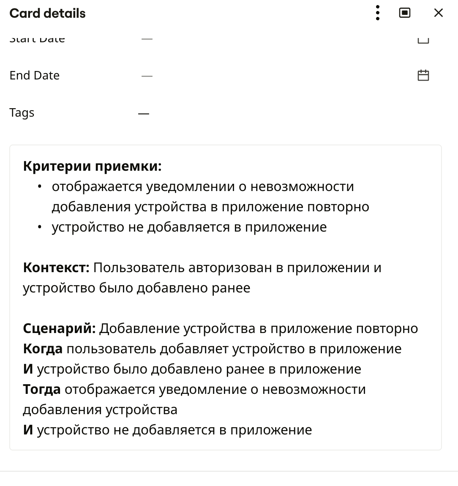

Подробные Gherkin-сценарии для ключевых историй MVP зафиксированы в карточках историй на самой карте Miro. Пример критериев приемки для User Story "Повторное добавление устройства" см. на скриншоте ниже:

