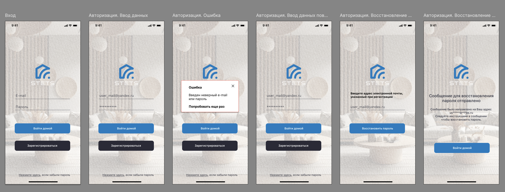
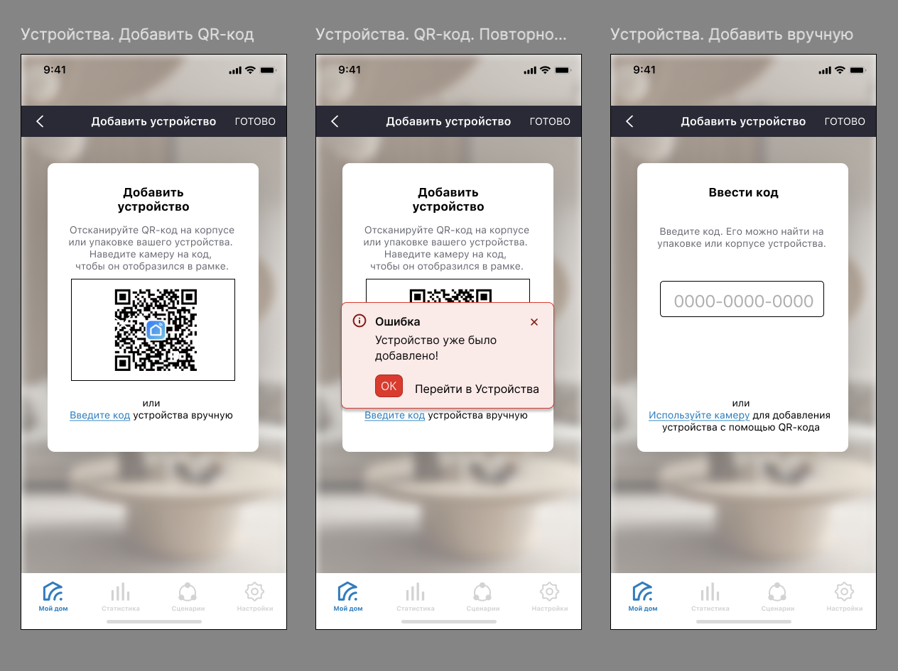
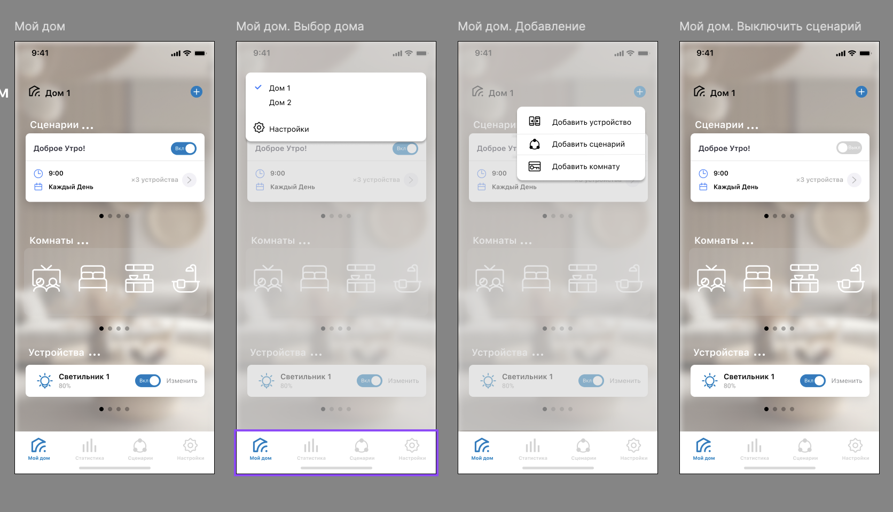

# 04_Prototyping: Прототип приложения «Stets Home»

**Инструмент:** Figma

## Описание
Разработан интерактивный кликабельный прототип MVP-версии приложения «Stets Home». Прототип полностью эмулирует пользовательский опыт: все кнопки и переходы между экранами активны.

**Ссылка на интерактивный прототип:** 
[[https://www.figma.com/link/to/your/prototype](https://www.figma.com/design/IIkj7RJlJnhNpykxxidkGb/%D0%9F%D1%80%D0%BE%D1%82%D0%BE%D1%82%D0%B8%D0%BF-%D0%BF%D1%80%D0%B8%D0%BB%D0%BE%D0%B6%D0%B5%D0%BD%D0%B8%D1%8F-Stets-Home?node-id=20701-579&t=pcqveqDkyyqUuBXZ-1)]([[https://www.figma.com/link/to/your/prototype](https://www.figma.com/design/IIkj7RJlJnhNpykxxidkGb/%D0%9F%D1%80%D0%BE%D1%82%D0%BE%D1%82%D0%B8%D0%BF-%D0%BF%D1%80%D0%B8%D0%BB%D0%BE%D0%B6%D0%B5%D0%BD%D0%B8%D1%8F-Stets-Home?node-id=20701-579&t=pcqveqDkyyqUuBXZ-1)])

## Реализованные сценарии MVP

В рамках первой версии приложения спроектированы ключевые пользовательские пути, подтвержденные на этапе сбора требований.

### 1. Онбординг и управление аккаунтом
Реализован безопасный вход в систему и первичная навигация.
*   **Окно авторизации:** Вход по Email и паролю.
*   **Валидация:** Сценарий обработки ошибки при вводе неверного пароля.
*   **Восстановление:** Сценарий восстановления доступа через email.

*Визуализация: См. скриншот `figma-auth.png`.*

### 2. Управление устройствами (Smart Home Setup)
Обеспечено быстрое добавление новых устройств в экосистему с защитой от ошибок.
*   **Добавление через QR-код:** Основной сценарий добавления устройства с помощью сканера.
*   **Добавление вручную:** Резервный сценарий ввода уникального ID устройства (на случай повреждения QR-кода).
*   **Валидация дубликатов:** Сценарий вывода ошибки при попытке добавить устройство, которое уже зарегистрировано в системе.

*Визуализация: См. скриншот `figma-add-device.png`.*

### 3. Главный экран (Home) и навигация
Центральная точка управления умным домом, обеспечивающая быстрый доступ к основным сущностям.
*   **Выбор дома:** Возможность переключения между несколькими домами (актуально для реализации требования о совместном доступе).
*   **Дашборд:** Отображение устройств с возможностью быстрого включения/выключения.
*   **Основное меню (Action Bar):** Ключевые действия для пользователя:
    *   Добавить устройство (`+ Device`)
    *   Добавить сценарий (`+ Scenario`)
    *   Добавить комнату (`+ Room`)

*Визуализация: См. скриншот `figma-home.png`.*

## Галерея экранов (Скриншоты)

| Авторизация и валидация | Добавление устройств | Главный экран |
| :--- | :--- | :--- |
|  |  |  |
